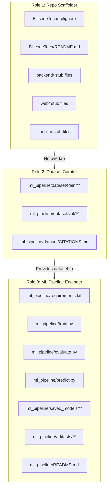

# Monorepo & ML Pipeline Technical Analysis (Day 1)
**Project:** Smart Waste Management System (SWMS)  
**Target Assessment:** Bilcode Technology Fullstack Developer Technical Coding Test  
**Working Directory:** `D:\Ngoding\interviewWeb\BillcodeTech`  
**Date:** 2026-11-01  
**Author:** Teamwork Explorer Agent (`explorer_repo_1`)

---

## 1. Executive Summary

This investigation surveys the current workspace filesystem, git repository boundaries, runtime environments, and architectural documentation in `D:\Ngoding\interviewWeb\BillcodeTech`. It defines the exact monorepo directory layout, dataset structure, training pipeline architecture, evaluation artifacts, and file ownership boundaries required for **Day 1** of the 5-Day Implementation Roadmap (`docs/TASKS.md`).

Key findings include:
1. **Git & Monorepo Boundaries:** The active git root is at parent directory `D:\Ngoding\interviewWeb`, which holds multiple interview folders (`BillcodeTech/`, `SusiAir/`, `Xolvon/`). `BillcodeTech` itself is untracked and currently lacks root config files (`.gitignore`, `README.md`). It requires its own dedicated `.gitignore` and `README.md` to function as an independent, public-ready monorepo deliverable.
2. **Environment & Toolchain Readiness:** Node.js (v24.12.0), npm (11.5.1), Flutter (3.41.1), Dart (3.11.0), Git (2.49.0), and Python (3.12.6) are present on the host. However, the system's global Python environment contains an incomplete `torch` installation triggering `ImportError: DLL load failed while importing _C`. Pip's local cache already contains the official Windows CPU wheels (`torch-2.15.0+cpu`, `torchvision-0.29.2+cpu`), allowing rapid and reliable setup inside a clean virtual environment or targeted pip installation.
3. **Day 1 Scope:** Establishing monorepo directories (`backend/`, `ml_pipeline/`, `web/`, `mobile/`, `docs/`), curating $\ge 150$ images across 3 waste categories (`organic`, `plastic`, `paper`) with an 80/20 train/val split, developing PyTorch MobileNetV2 transfer learning training and evaluation scripts, and exporting `waste_model.pth` alongside evaluation artifacts (`confusion_matrix.png`, `accuracy_curve.png`, `classification_report.txt` with test accuracy $\ge 80\%$, target $\ge 85\%$).

---

## 2. Workspace & Environment Survey

### 2.1 Directory & Git Boundary Analysis

| Directory | Type | Git State | Notes |
| :--- | :--- | :--- | :--- |
| `D:\Ngoding\interviewWeb` | Parent Workspace | Git root (`.git/`) | Branch `main`. Contains legacy deleted files (`README.md`, `style.css`, etc.) and untracked interview folders. |
| `D:\Ngoding\interviewWeb\BillcodeTech` | Project Monorepo Root | Untracked in parent `.git` | Dedicated directory for Bilcode take-home test. No independent `.git` directory yet. |
| `D:\Ngoding\interviewWeb\BillcodeTech\.agents` | Metadata Folder | Local agent state | Contains orchestrator and agent coordination files. Must not contain application source. |
| `D:\Ngoding\interviewWeb\BillcodeTech\docs` | Specification Docs | Ready & Complete | 10 comprehensive markdown documents (`PRD.md`, `SPEC.md`, `ARCHITECTURE.md`, `ADR.md`, `ERD.md`, `API_SPECS.md`, `STYLING_GUIDE.md`, `TASKS.md`, `RUNBOOK.md`, `FLOWS.md`). |

#### Git Recommendation for Delivery
`docs/PRD.md` (Checklist Item 1) and `docs/TASKS.md` (Task 5.5) require submitting a standalone public GitHub repository for `BillcodeTech`.
- `BillcodeTech` must maintain its own comprehensive `.gitignore` at its root.
- All subsequent workers must perform file creation inside `D:\Ngoding\interviewWeb\BillcodeTech`.

### 2.2 Host Runtime & Toolchain Status

- **Operating System:** Windows (AMD64)
- **Python:** `3.12.6` (`C:\Users\MyBook Hype AMD\AppData\Local\Programs\Python\Python312\python.exe`)
- **Node.js:** `v24.12.0`
- **npm:** `11.5.1`
- **Flutter:** `3.41.1` (Channel stable, Dart `3.11.0`)
- **Git:** `2.49.0.windows.1`

### 2.3 PyTorch Environment Investigation & Resolution

When executing `python -c "import torch"`, Python threw:
```text
ImportError: DLL load failed while importing _C: The specified module could not be found.
```
Investigation revealed that `pip show torch` returns `Package(s) not found: torch`, indicating a damaged or partial folder in global `site-packages`. 

Testing a dry-run install with the official CPU index (`https://download.pytorch.org/whl/cpu`):
```bash
pip install --dry-run torch torchvision --index-url https://download.pytorch.org/whl/cpu
```
confirmed that the official Windows CPU wheels:
- `torch-2.15.0+cpu-cp312-cp312-win_amd64.whl` (126.6 MB)
- `torchvision-0.29.2+cpu-py3-none-win_amd64.whl` (1.4 MB)

are **already cached locally** on disk. Installing torch into a dedicated virtual environment (`venv`) or reinstalling with `--force-reinstall` via the CPU wheel index will execute in under 30 seconds without network delays or missing DLL issues.

---

## 3. Detailed Day 1 Monorepo Architecture

To satisfy **R1** (`docs/TASKS.md` Task 1.1) and all technical specifications in `docs/SPEC.md`, the repository structure must be organized as follows:

```text
BillcodeTech/
├── .gitignore                        # Global ignore rules (Python, Node, Flutter, OS, large binaries)
├── README.md                         # Main repository guide, architecture overview & quickstart
│
├── docs/                             # Architecture & specification files (EXISTING - DO NOT ALTER)
│   ├── ADR.md
│   ├── API_SPECS.md
│   ├── ARCHITECTURE.md
│   ├── ERD.md
│   ├── FLOWS.md
│   ├── PRD.md
│   ├── RUNBOOK.md
│   ├── SPEC.md
│   ├── STYLING_GUIDE.md
│   └── TASKS.md
│
├── ml_pipeline/                      # Day 1 Core Implementation: PyTorch ML Pipeline
│   ├── README.md                     # ML setup instructions, training guide, and evaluation summary
│   ├── requirements.txt              # PyTorch, Torchvision, Scikit-learn, Matplotlib, Seaborn, Pillow, NumPy
│   ├── train.py                      # MobileNetV2 Transfer Learning training script (with augmentation)
│   ├── evaluate.py                   # Model evaluation, confusion matrix & metrics generation
│   ├── predict.py                    # Inference helper module for standalone testing & backend import
│   ├── waste_model.pth               # Exported model weights (root convenience copy for root inspection)
│   ├── confusion_matrix.png          # Evaluation artifact (root convenience copy)
│   ├── accuracy_curve.png            # Loss & accuracy curves artifact (root convenience copy)
│   ├── classification_report.txt     # Text report containing precision, recall, f1-score (root convenience copy)
│   ├── dataset/                      # Curated 150+ waste images (80/20 train/val partition)
│   │   ├── CITATIONS.md              # Public data sources, license attributes, and dataset breakdown
│   │   ├── train/                    # 80% partition (~40+ images per class, total >= 120 images)
│   │   │   ├── organic/
│   │   │   ├── plastic/
│   │   │   └── paper/
│   │   └── val/                      # 20% partition (~10+ images per class, total >= 30 images)
│   │       ├── organic/
│   │       ├── plastic/
│   │       └── paper/
│   ├── saved_models/                 # Exported weights & model metadata directory
│   │   ├── waste_model.pth           # Canonical exported PyTorch model weights
│   │   └── model_metadata.json       # Class mappings, hyperparameters, and test accuracy record
│   └── artifacts/                    # Evaluation artifacts directory
│       ├── confusion_matrix.png      # High-res Seaborn/Matplotlib heatmap
│       ├── accuracy_curve.png        # Training vs Validation loss and accuracy curves
│       └── classification_report.txt # Per-class precision, recall, F1-score & support
│
├── backend/                          # FastAPI Backend Stub (Day 1 Scaffold, Day 2 Full Build)
│   ├── README.md                     # Backend overview, API endpoints, and development guide
│   ├── requirements.txt              # FastAPI, Uvicorn, SQLAlchemy, Alembic, Pydantic, PyTorch, Pytest
│   ├── Dockerfile                    # Containerization definition
│   ├── uploads/                      # Uploads directory for evidence photos
│   │   └── .gitkeep
│   ├── tests/                        # Automated tests suite
│   │   ├── __init__.py
│   │   └── test_health.py            # Baseline health check test
│   └── app/
│       ├── __init__.py
│       ├── main.py                   # FastAPI application factory with root health check
│       ├── api/
│       │   ├── __init__.py
│       │   └── v1/
│       │       ├── __init__.py
│       │       └── router.py         # Sub-router stub
│       ├── core/
│       │   ├── __init__.py
│       │   ├── config.py             # Pydantic BaseSettings stub
│       │   └── database.py           # Database connection & SessionLocal stub
│       ├── models/
│       │   └── __init__.py           # SQLAlchemy models stub
│       ├── schemas/
│       │   └── __init__.py           # Pydantic schemas stub
│       └── services/
│           ├── __init__.py           # Service layer stub
│           └── inference.py          # AI model loader stub interfacing ml_pipeline model
│
├── web/                              # Next.js Web Dashboard Stub (Day 1 Scaffold, Day 3 Full Build)
│   ├── README.md                     # Web portal documentation & setup
│   ├── package.json                  # Next.js 14+ dependencies, scripts (dev, build, start, lint)
│   ├── tsconfig.json                 # TypeScript compiler configuration
│   ├── tailwind.config.ts            # Tailwind styling tokens per STYLING_GUIDE.md
│   └── src/
│       └── app/
│           ├── layout.tsx            # Root HTML layout with Space Grotesk & Inter font wrappers
│           └── page.tsx              # Minimal placeholder dashboard page
│
└── mobile/                           # Flutter Mobile Application Stub (Day 1 Scaffold, Day 4 Full Build)
    ├── README.md                     # Mobile app overview & execution guide
    ├── pubspec.yaml                  # Flutter package definition & dependencies (geolocator, camera, http)
    └── lib/
        └── main.dart                 # Flutter entrypoint stub
```

---

## 4. Detailed Component Specifications for Day 1

### 4.1 Root `.gitignore` Specification

A clean `.gitignore` is essential to prevent committing gigabytes of node dependencies, virtual environments, build outputs, and credentials.

```gitignore
# Python & Virtual Environments
__pycache__/
*.py[cod]
*$py.class
*.so
.Python
env/
venv/
.venv/
ENV/
build/
develop-eggs/
dist/
downloads/
eggs/
.eggs/
lib/
lib64/
parts/
sdist/
var/
wheels/
*.egg-info/
.installed.cfg
*.egg
.pytest_cache/
.coverage
htmlcov/

# Node.js & Next.js
node_modules/
.next/
out/
npm-debug.log*
yarn-debug.log*
yarn-error.log*
.pnpm-debug.log*

# Flutter & Dart
.dart_tool/
.flutter-plugins
.flutter-plugins-dependencies
.packages
mobile/build/
mobile/.dart_tool/
*.apk
*.aab

# Static Uploads & Local Media
backend/uploads/*
!backend/uploads/.gitkeep

# Environment Variables & Secrets
.env
.env.local
.env.*.local
*.pem
*.key

# Operating System & IDEs
.DS_Store
Thumbs.db
.vscode/
.idea/
*.sublime-project
*.sublime-workspace
```

---

### 4.2 Machine Learning Pipeline Specification (`ml_pipeline/`)

#### A. Dataset Requirements (`R2`)
- **Categories:** Exactly 3 classes matching `docs/PRD.md` and `docs/ERD.md`:
  1. `organic` (e.g. food waste, leaves, fruit peels)
  2. `plastic` (e.g. plastic bottles, packaging, straws, containers)
  3. `paper` (e.g. cardboard boxes, paper sheets, newspapers)
- **Volume:** $\ge 150$ total images (minimum 50 images per class).
- **Partition:** 80% Training ($\ge 40$ images/class, total $\ge 120$ images), 20% Validation/Testing ($\ge 10$ images/class, total $\ge 30$ images).
- **Structure:**
  ```text
  ml_pipeline/dataset/
  ├── train/
  │   ├── organic/
  │   ├── plastic/
  │   └── paper/
  └── val/
      ├── organic/
      ├── plastic/
      └── paper/
  ```
- **Documentation (`CITATIONS.md`):** Must list source repositories (e.g. Kaggle Waste Classification, TrashNet, public domain image repositories), image resolution, license details, and train/val split breakdown.

#### B. Model Architecture & Training Pipeline (`R3`)
- **Base Architecture:** `torchvision.models.mobilenet_v2(weights=MobileNet_V2_Weights.DEFAULT)`.
- **Transfer Learning Strategy:**
  - Freeze initial feature extraction layers (`for param in model.features.parameters(): param.requires_grad = False`).
  - Replace the classifier head:
    ```python
    model.classifier = nn.Sequential(
        nn.Dropout(p=0.2),
        nn.Linear(model.last_channel, 3) # 3 classes: organic, plastic, paper
    )
    ```
- **Data Augmentation:**
  - *Train Transforms:* `Resize((224, 224))`, `RandomHorizontalFlip(p=0.5)`, `RandomRotation(degrees=15)`, `ColorJitter(brightness=0.1, contrast=0.1)`, `ToTensor()`, `Normalize(mean=[0.485, 0.456, 0.406], std=[0.229, 0.224, 0.225])`.
  - *Val/Test Transforms:* `Resize((224, 224))`, `ToTensor()`, `Normalize(mean=[0.485, 0.456, 0.406], std=[0.229, 0.224, 0.225])`.
- **Training Hyperparameters:**
  - Epochs: 15
  - Batch size: 16
  - Optimizer: `optim.Adam(model.classifier.parameters(), lr=0.001)` or `optim.SGD(..., lr=0.01, momentum=0.9)`
  - Loss function: `nn.CrossEntropyLoss()`
  - Metric threshold: Validation Accuracy $\ge 80\%$ (target $\ge 85\%$).
  - Best model checkpointing based on highest validation accuracy.

#### C. Evaluation & Artifact Generation (`R4`)
- **Model Export:**
  - File: `waste_model.pth` (saved in `ml_pipeline/saved_models/waste_model.pth` and duplicated to `ml_pipeline/waste_model.pth` for immediate availability).
  - Format: PyTorch `state_dict` or complete serialized model.
- **Evaluation Outputs:**
  1. `confusion_matrix.png`: Plotted using `sklearn.metrics.confusion_matrix` and `seaborn.heatmap` with class labels `['Organic', 'Paper', 'Plastic']`.
  2. `accuracy_curve.png`: Dual subplots displaying Training vs. Validation Loss and Training vs. Validation Accuracy across all epochs.
  3. `classification_report.txt`: Text export of `sklearn.metrics.classification_report` presenting Precision, Recall, F1-Score, and Support for each class, plus Macro and Weighted averages.
  - Placed in both `ml_pipeline/artifacts/` and `ml_pipeline/` root.

---

## 5. File Ownership & Concurrency Boundaries

To ensure parallel execution without race conditions or merge conflicts, files are strictly partitioned across 3 specialized roles:



### Detailed Ownership Matrix

| File / Directory Path | Owning Role | Write Access | Read Access | Notes |
| :--- | :--- | :---: | :---: | :--- |
| `BillcodeTech/.gitignore` | Repo Scaffolder | Exclusive | All | Must include Python, Node, Flutter, OS rules. |
| `BillcodeTech/README.md` | Repo Scaffolder | Exclusive | All | Monorepo root overview & status. |
| `BillcodeTech/docs/**` | **PRESERVED** | **NONE** | All | Existing docs are locked source of truth. |
| `BillcodeTech/backend/**` | Repo Scaffolder | Exclusive | All | Stubs for Day 2 FastAPI work. |
| `BillcodeTech/web/**` | Repo Scaffolder | Exclusive | All | Stubs for Day 3 Next.js work. |
| `BillcodeTech/mobile/**` | Repo Scaffolder | Exclusive | All | Stubs for Day 4 Flutter work. |
| `BillcodeTech/ml_pipeline/dataset/**` | Dataset Curator | Exclusive | ML Engineer | $\ge 150$ images in 80/20 train/val structure. |
| `BillcodeTech/ml_pipeline/dataset/CITATIONS.md` | Dataset Curator | Exclusive | All | Data source documentation. |
| `BillcodeTech/ml_pipeline/train.py` | ML Engineer | Exclusive | All | PyTorch training logic. |
| `BillcodeTech/ml_pipeline/evaluate.py` | ML Engineer | Exclusive | All | Metrics & plots generator. |
| `BillcodeTech/ml_pipeline/predict.py` | ML Engineer | Exclusive | All | Standalone inference helper. |
| `BillcodeTech/ml_pipeline/requirements.txt` | ML Engineer | Exclusive | All | Python dependencies. |
| `BillcodeTech/ml_pipeline/saved_models/**` | ML Engineer | Exclusive | All | `waste_model.pth` and metadata. |
| `BillcodeTech/ml_pipeline/artifacts/**` | ML Engineer | Exclusive | All | Plots and classification report. |
| `BillcodeTech/ml_pipeline/README.md` | ML Engineer | Exclusive | All | Instructions for ML module. |

---

## 6. Execution Recommendations for Downstream Agents

### Phase 1: Foundation Scaffolding (Worker: Scaffolder)
1. Write root `BillcodeTech/.gitignore`.
2. Write root `BillcodeTech/README.md` summarizing the project, tech stack, and roadmap.
3. Create `backend/` directory structure with stubs (`app/main.py`, `app/core/`, `app/api/v1/`, `requirements.txt`, `tests/test_health.py`, `README.md`).
4. Create `web/` directory structure with stubs (`package.json`, `tsconfig.json`, `tailwind.config.ts`, `src/app/layout.tsx`, `src/app/page.tsx`, `README.md`).
5. Create `mobile/` directory structure with stubs (`pubspec.yaml`, `lib/main.dart`, `README.md`).

### Phase 2: Dataset Curation (Worker: Dataset Curator)
1. Create `ml_pipeline/dataset/train/{organic,plastic,paper}` and `ml_pipeline/dataset/val/{organic,plastic,paper}`.
2. Source and curate 150+ real-world images of waste (minimum 50 images per category: $\ge 40$ train, $\ge 10$ val).
3. Validate that all images are valid JPEGs/PNGs of appropriate resolution (224x224 or scalable).
4. Write `ml_pipeline/dataset/CITATIONS.md` documenting source citations, licensing, and exact image distribution.

### Phase 3: ML Training & Evaluation (Worker: ML Engineer)
1. Write `ml_pipeline/requirements.txt` with pinned dependencies (`torch`, `torchvision`, `scikit-learn`, `matplotlib`, `seaborn`, `pillow`, `numpy`).
2. Implement `ml_pipeline/train.py` featuring:
   - Data augmentation for training set.
   - MobileNetV2 with pre-trained weights and fine-tuned classifier head (3 classes).
   - Validation tracking per epoch and best weight checkpointing.
   - CLI flags: `--epochs`, `--batch-size`, `--lr`, `--data-dir`, `--model-dir`, `--artifacts-dir`.
3. Implement `ml_pipeline/evaluate.py` to:
   - Load saved weights and evaluate against validation set.
   - Output `confusion_matrix.png`, `accuracy_curve.png`, and `classification_report.txt`.
   - Verify validation accuracy meets or exceeds the 80% threshold (target $\ge 85\%$).
4. Implement `ml_pipeline/predict.py` for standalone inference testing on sample images.
5. Export `waste_model.pth` and place copies in both `saved_models/` and `ml_pipeline/` root for ease of access by Backend Day 2.

---

## 7. Verification Strategy & Acceptance Checklist

To independently verify Day 1 completion, the following automated checks should be executed:

```powershell
# 1. Verify Monorepo Structure
Test-Path BillcodeTech\backend\app\main.py
Test-Path BillcodeTech\web\package.json
Test-Path BillcodeTech\mobile\pubspec.yaml
Test-Path BillcodeTech\ml_pipeline\requirements.txt
Test-Path BillcodeTech\docs\TASKS.md

# 2. Verify Dataset Image Counts (Total >= 150, each category >= 50, ~80/20 train/val)
$trainOrganic = (Get-ChildItem BillcodeTech\ml_pipeline\dataset\train\organic -File).Count
$trainPlastic = (Get-ChildItem BillcodeTech\ml_pipeline\dataset\train\plastic -File).Count
$trainPaper   = (Get-ChildItem BillcodeTech\ml_pipeline\dataset\train\paper -File).Count
$valOrganic   = (Get-ChildItem BillcodeTech\ml_pipeline\dataset\val\organic -File).Count
$valPlastic   = (Get-ChildItem BillcodeTech\ml_pipeline\dataset\val\plastic -File).Count
$valPaper     = (Get-ChildItem BillcodeTech\ml_pipeline\dataset\val\paper -File).Count

$totalImages = $trainOrganic + $trainPlastic + $trainPaper + $valOrganic + $valPlastic + $valPaper
Write-Host "Total Images: $totalImages"
# Must be >= 150, train >= 120, val >= 30, each class >= 50

# 3. Verify Model Weights & Artifacts
Test-Path BillcodeTech\ml_pipeline\waste_model.pth
Test-Path BillcodeTech\ml_pipeline\confusion_matrix.png
Test-Path BillcodeTech\ml_pipeline\accuracy_curve.png
Test-Path BillcodeTech\ml_pipeline\classification_report.txt

# 4. Verify Model Loadability via Python
python -c "import torch, torchvision; model = torchvision.models.mobilenet_v2(); model.classifier[1] = torch.nn.Linear(model.last_channel, 3); model.load_state_dict(torch.load('BillcodeTech/ml_pipeline/waste_model.pth', map_location='cpu')); print('Model loaded successfully!')"
```
