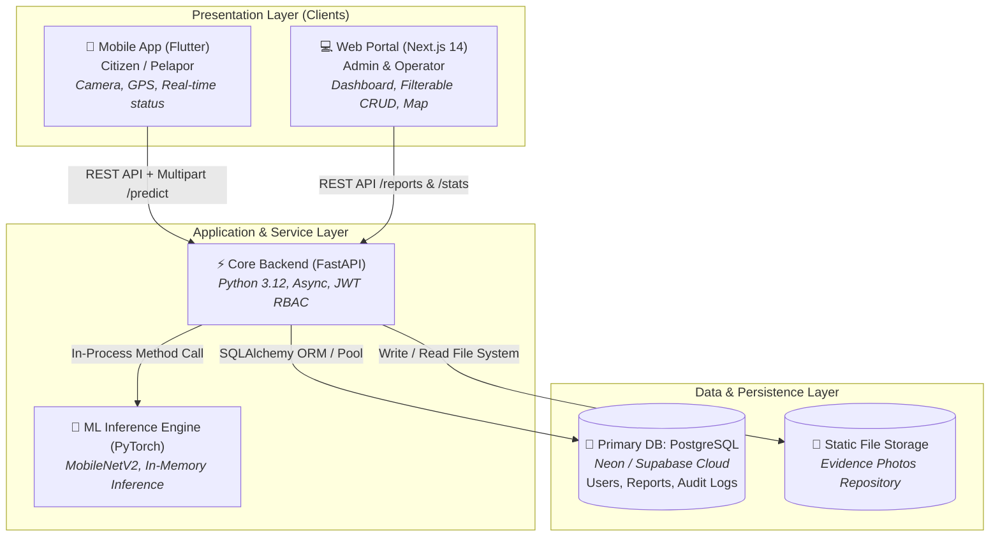

# System Architecture Document (SAD)
## Smart Waste Management System (SWMS)

---

## 1. C4 Container Architecture Diagram



---

## 2. Component Layering & Separation of Concerns

### A. Presentation Layer (Decoupled Clients)
1. **Next.js Web Portal (`/web`)**:
   * **Rendering Mode:** Client-side Components (`'use client'`) for authenticated dashboard interactions + Server Components for static marketing shell.
   * **State Management:** SWR / React Query pattern for optimistic UI updates and live caching.
   * **Styling Engine:** Tailwind CSS with custom font tokens (`Space Grotesk` headings + `Inter` body).
2. **Flutter Mobile Application (`/mobile`)**:
   * **Pattern:** Service-Oriented Layered Architecture (`Presentation -> State -> Service -> Data Provider`).
   * **Hardware Access:** Native camera pipeline (`image_picker`) and native GNSS hardware (`geolocator`).

### B. Application & AI Engine Layer (`/backend`)
* **Unified Process:** Menghindari *network hop latency* antar-microservice. FastAPI memuat bobot model PyTorch (`.pth`) ke dalam memory RAM saat startup (*Lifespan Handler*).
* **Dependency Injection:** Database sessions (`SessionLocal`) dan authentication guards (`get_current_admin`) disuntikkan secara deklaratif menggunakan fitur `Depends()` bawaan FastAPI.
* **Pydantic Validation:** Batas kontrak ketat pada input dan output (kebal SQL Injection dan XSS).

### C. Data & Persistence Layer
* **PostgreSQL:** Penyimpanan transaksi relasional berintegritas tinggi.
* **Audit Trail (`report_logs`):** Setiap perubahan status tercatat secara *immutable* (tidak bisa di-update/delete), mencatat siapa yang mengubah, kapan, dan alasan perubahan.

---

## 3. Deployment Topology & Cloud Infrastructure

```text
[ Citizen Device ]          [ Admin Workstation ]
        │                            │
        ▼ (HTTPS)                    ▼ (HTTPS)
   Flutter App                Vercel Edge Network
   (Release APK)             (Next.js Frontend Build)
        │                            │
        └──────────────┬─────────────┘
                       ▼ (HTTPS JSON / Multipart)
               Render.com / Railway
               (FastAPI Docker Container)
                 ├── PyTorch Model (CPU optimized)
                 └── Uploads Storage
                       │
                       ▼ (Secure TLS Connection)
               Neon.tech / Supabase
               (PostgreSQL 16 Database)
```
