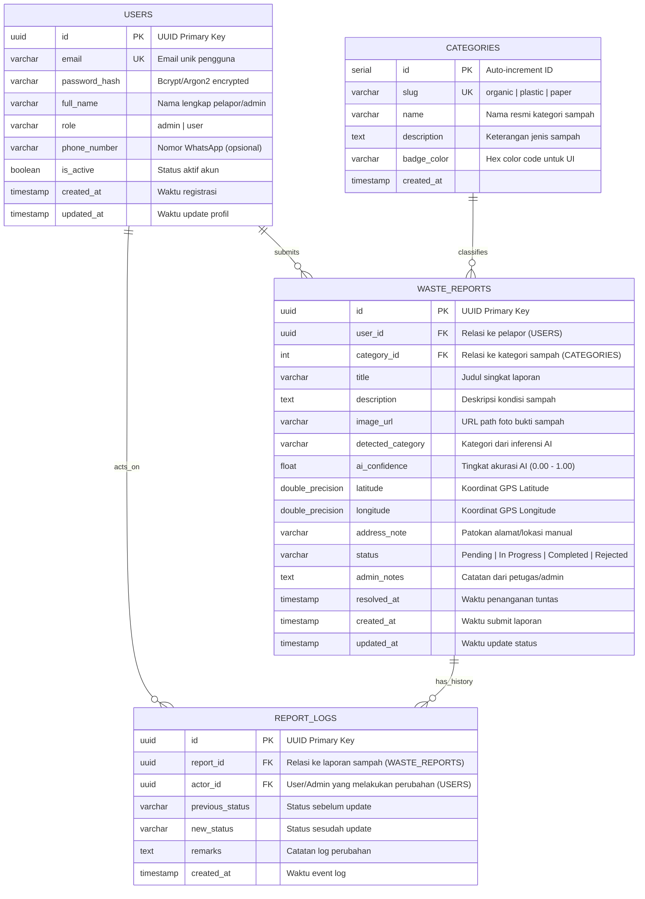

# Entity Relationship Diagram (ERD) & Database Schema
## Smart Waste Management System (SWMS)

> 🎨 **Diagram Design Hub:** Versi visual editorial beresolusi tinggi (self-contained SVG/HTML) tersedia di:
> - 📐 **ERD Relational Schema Standalone:** [`docs/diagrams/erd-database.html`](diagrams/erd-database.html)
> - 🌐 **Interactive Diagram Hub:** [`docs/diagrams/index.html`](diagrams/index.html)

---

### 1. Visual Entity Relationship Diagram (Mermaid)



---

### 2. SQL DDL Script (PostgreSQL Syntax)

```sql
-- Ekstensi UUID
CREATE EXTENSION IF NOT EXISTS "uuid-ossp";

-- 1. TABEL USERS
CREATE TABLE users (
    id UUID PRIMARY KEY DEFAULT uuid_generate_v4(),
    email VARCHAR(255) UNIQUE NOT NULL,
    password_hash VARCHAR(255) NOT NULL,
    full_name VARCHAR(150) NOT NULL,
    role VARCHAR(20) NOT NULL DEFAULT 'user' CHECK (role IN ('admin', 'user')),
    phone_number VARCHAR(30),
    is_active BOOLEAN DEFAULT TRUE,
    created_at TIMESTAMP WITH TIME ZONE DEFAULT CURRENT_TIMESTAMP,
    updated_at TIMESTAMP WITH TIME ZONE DEFAULT CURRENT_TIMESTAMP
);

-- Indexing Users
CREATE INDEX idx_users_email ON users(email);
CREATE INDEX idx_users_role ON users(role);

-- 2. TABEL CATEGORIES (Master Kategori Sampah)
CREATE TABLE categories (
    id SERIAL PRIMARY KEY,
    slug VARCHAR(50) UNIQUE NOT NULL,
    name VARCHAR(100) NOT NULL,
    description TEXT,
    badge_color VARCHAR(20) DEFAULT '#059669',
    created_at TIMESTAMP WITH TIME ZONE DEFAULT CURRENT_TIMESTAMP
);

-- Seed Awal Kategori
INSERT INTO categories (slug, name, description, badge_color) VALUES
('organic', 'Organic Waste', 'Sisa makanan, dedaunan, sayuran, dan bahan mudah terurai', '#16a34a'),
('plastic', 'Plastic Waste', 'Botol plastik, kantong kresek, kemasan sachet, sedotan', '#0284c7'),
('paper', 'Paper Waste', 'Kertas karton, kardus, koran bekas, dokumen kertas', '#d97706');

-- 3. TABEL WASTE_REPORTS
CREATE TABLE waste_reports (
    id UUID PRIMARY KEY DEFAULT uuid_generate_v4(),
    user_id UUID NOT NULL REFERENCES users(id) ON DELETE CASCADE,
    category_id INT NOT NULL REFERENCES categories(id) ON DELETE RESTRICT,
    title VARCHAR(200) NOT NULL,
    description TEXT,
    image_url VARCHAR(500) NOT NULL,
    detected_category VARCHAR(100),
    ai_confidence REAL DEFAULT 0.0,
    latitude DOUBLE PRECISION NOT NULL,
    longitude DOUBLE PRECISION NOT NULL,
    address_note VARCHAR(255),
    status VARCHAR(30) NOT NULL DEFAULT 'Pending' 
        CHECK (status IN ('Pending', 'In Progress', 'Completed', 'Rejected')),
    admin_notes TEXT,
    resolved_at TIMESTAMP WITH TIME ZONE,
    created_at TIMESTAMP WITH TIME ZONE DEFAULT CURRENT_TIMESTAMP,
    updated_at TIMESTAMP WITH TIME ZONE DEFAULT CURRENT_TIMESTAMP
);

-- Indexing Waste Reports
CREATE INDEX idx_reports_user_id ON waste_reports(user_id);
CREATE INDEX idx_reports_category_id ON waste_reports(category_id);
CREATE INDEX idx_reports_status ON waste_reports(status);
CREATE INDEX idx_reports_created_at ON waste_reports(created_at DESC);

-- 4. TABEL REPORT_LOGS (Audit Trail Status Perubahan)
CREATE TABLE report_logs (
    id UUID PRIMARY KEY DEFAULT uuid_generate_v4(),
    report_id UUID NOT NULL REFERENCES waste_reports(id) ON DELETE CASCADE,
    actor_id UUID NOT NULL REFERENCES users(id) ON DELETE SET NULL,
    previous_status VARCHAR(30),
    new_status VARCHAR(30) NOT NULL,
    remarks TEXT,
    created_at TIMESTAMP WITH TIME ZONE DEFAULT CURRENT_TIMESTAMP
);

CREATE INDEX idx_logs_report_id ON report_logs(report_id);
```
