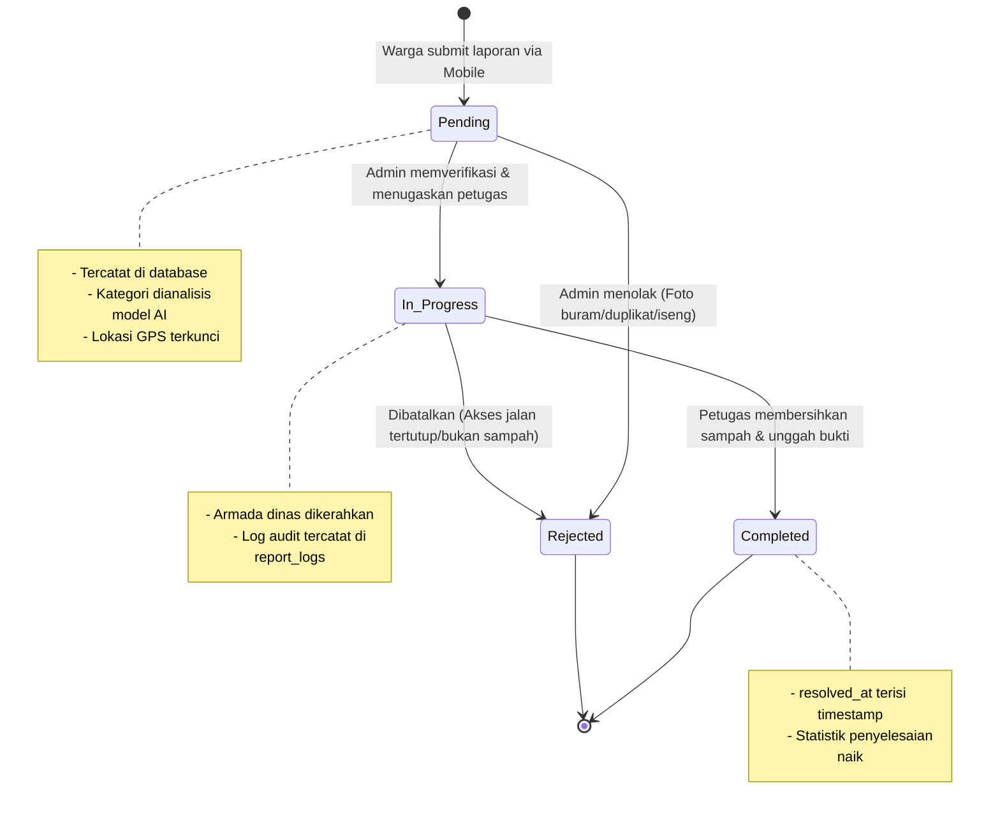
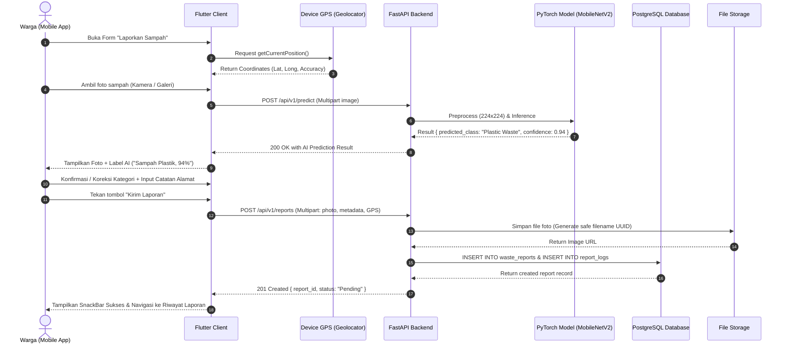
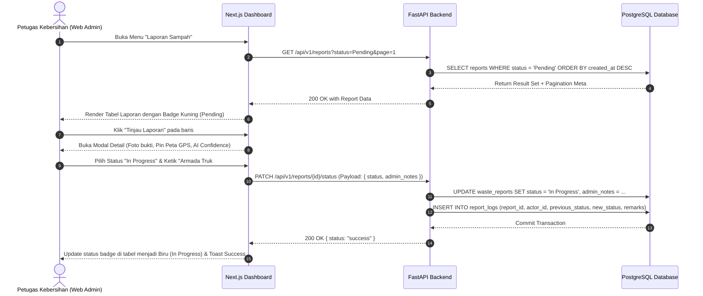
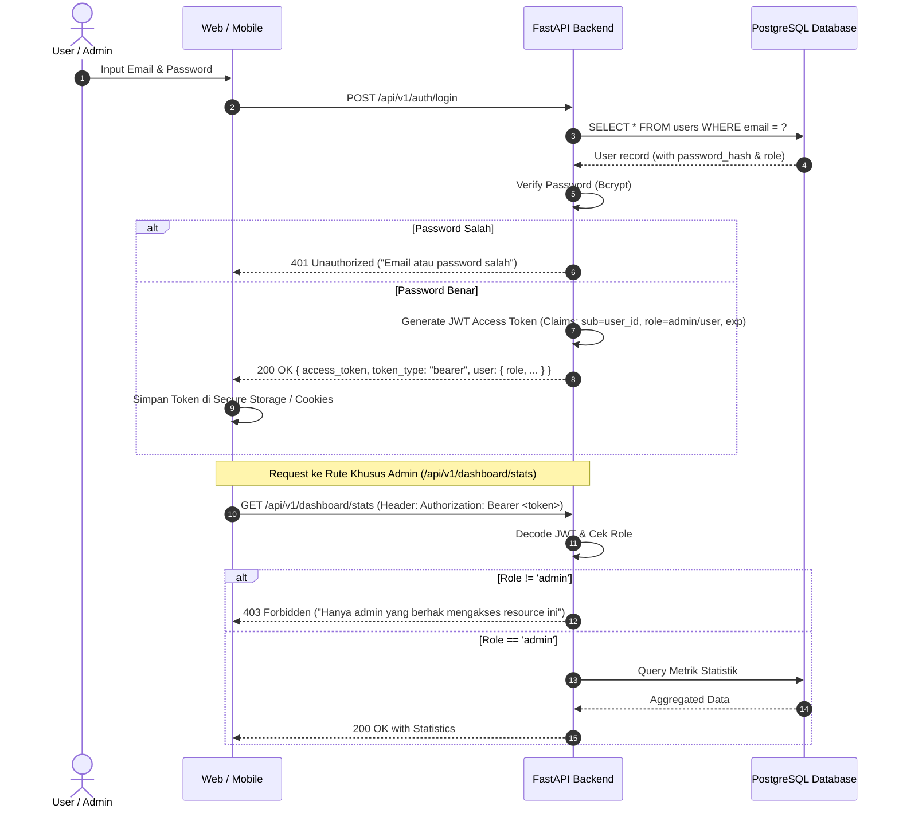

# System Workflows & Sequence Diagrams (FLOWS)
## Smart Waste Management System (SWMS)

> 🎨 **Diagram Design Hub:** Versi visual editorial beresolusi tinggi (self-contained SVG/HTML) tersedia di:
> - 🔄 **State Machine Standalone:** [`docs/diagrams/report-lifecycle-state.html`](diagrams/report-lifecycle-state.html)
> - ⚡ **Citizen Reporting Sequence Standalone:** [`docs/diagrams/citizen-reporting-sequence.html`](diagrams/citizen-reporting-sequence.html)
> - 🌐 **Interactive Diagram Hub:** [`docs/diagrams/index.html`](diagrams/index.html)

> Dokumen ini memetakan seluruh alur kerja operasional, transisi *state machine*, diagram sekuens (*sequence diagram*), dan penanganan kondisi kritis (*edge cases*) untuk memastikan sistem bekerja presisi dari hulu ke hilir.

---

## 1. Waste Report Lifecycle (State Machine)

Setiap laporan sampah melewati siklus hidup dengan aturan transisi ketat untuk menjamin integritas data audit (*audit trail*).

### Aturan Transisi Status
| Dari Status | Ke Status | Aktor yang Berhak | Syarat & Efek Samping |
| :--- | :--- | :--- | :--- |
| `[Draft]` | **`Pending`** | Citizen (Mobile/Web) | Foto valid, GPS latitude/longitude tidak null. Notifikasi status masuk. |
| `Pending` | **`In Progress`** | Admin / Operator | Wajib mengisi catatan disposisi (`admin_notes`). Buat entri di `report_logs`. |
| `Pending` | **`Rejected`** | Admin | Wajib mengisi alasan penolakan (misal: "Foto bukan sampah", "Duplikat"). |
| `In Progress` | **`Completed`**| Admin | `resolved_at` otomatis terisi waktu saat ini. Laporan ditutup. |
| `In Progress` | **`Rejected`** | Admin | Jika armada tiba di lokasi namun titik sampah tidak ditemukan. |

---

## 2. Alur Utama 1: Pembuatan Laporan Sampah dengan AI & GPS (Mobile User)

---

## 3. Alur Utama 2: Tinjau & Update Status Laporan (Web Admin)

---

## 4. Alur Autentikasi & Otorisasi Berbasis Peran (RBAC)

---

## 5. Penanganan Kondisi Khusus & Kegagalan (Edge Cases)

### A. Kondisi: GPS Perangkat Tidak Aktif / Izin Ditolak
* **Gejala:** User mematikan lokasi di HP atau menolak izin GPS saat install.
* **Solusi Penanganan:**
  1. Aplikasi Flutter menampilkan dialog edukasi ramah: *"Izin lokasi dibutuhkan agar petugas tahu letak tumpukan sampah."*
  2. Jika user tetap menolak, aplikasi menyediakan input manual: **"Tulis Patokan Alamat Lengkap"** dan mengisi koordinat default pusat kota (misal: Balai Kota Jakarta) dengan flag `is_approximate_gps = true`.

### B. Kondisi: Tingkat Keyakinan AI Rendah (*Low Confidence* $< 50\%$)
* **Gejala:** Foto sampah diambil malam hari, gelap, buram, atau terlalu jauh.
* **Solusi Penanganan:**
  1. Endpoint `/predict` mengembalikan `confidence < 0.50`.
  2. Aplikasi Mobile tidak memaksakan auto-select, melainkan menampilkan peringatan halus: *"Foto agak buram. Mohon bantu pilih kategori sampah secara manual di bawah ini."*
  3. User tetap bisa memilih kategori secara manual (Organik, Plastik, atau Kertas).

### C. Kondisi: Koneksi Internet Terputus Saat Upload Foto
* **Gejala:** Pengguna berada di area sinyal lemah saat mengunggah foto berukuran beberapa MB.
* **Solusi Penanganan:**
  1. Aplikasi Flutter melakukan kompresi gambar lokal terlebih dahulu (maksimal resolusi $1080\text{p}$, kualitas $80\%$, ukuran $\le 800\text{ KB}$) sebelum dikirim via HTTP.
  2. Implementasi timeout 15 detik dengan tombol *Retry* otomatis tanpa menghapus data formulir yang sudah diisi.
