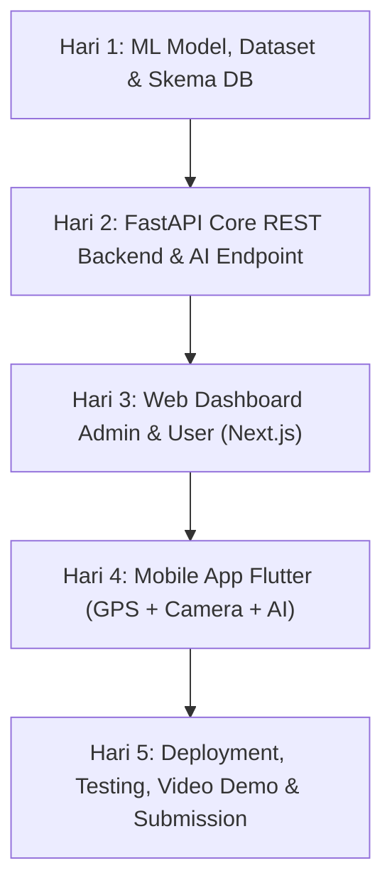

# 5-Day Implementation Roadmap & Task Breakdown
## Smart Waste Management System

### Milestone Schedule: 1 November – 6 November 2026

---

### Task Breakdown Rinci

#### [Day 1] Pondasi: Machine Learning & Database Architecture
- [ ] **Task 1.1:** Setup struktur monorepo (`backend`, `ml_pipeline`, `web`, `mobile`, `docs`).
- [ ] **Task 1.2:** Download & kurasi dataset 150+ gambar (Organic, Plastic, Paper) dengan pembagian 80% Train, 20% Val/Test.
- [ ] **Task 1.3:** Tulis script training PyTorch MobileNetV2 (`train.py`) dengan data augmentation.
- [ ] **Task 1.4:** Generate visualisasi metrik: `confusion_matrix.png`, `accuracy_curve.png`, dan `classification_report.txt` (Target Akurasi $\ge 85\%$).
- [ ] **Task 1.5:** Export bobot model ke `waste_model.pth`.

#### [Day 2] Core Backend API (FastAPI)
- [ ] **Task 2.1:** Inisialisasi FastAPI project dengan konfigurasi database PostgreSQL (SQLAlchemy + Alembic).
- [ ] **Task 2.2:** Implementasi model database (Users, WasteReports, Categories, ReportLogs).
- [ ] **Task 2.3:** Buat auth module (JWT Token, Hash Password, Role Guard: Admin/User).
- [ ] **Task 2.4:** Integrasi model PyTorch ke endpoint `POST /api/v1/predict`.
- [ ] **Task 2.5:** Buat CRUD endpoint laporan sampah (Upload gambar, kalkulasi status, filtering).
- [ ] **Task 2.6:** Verifikasi endpoint via Swagger UI (`http://localhost:8000/docs`).

#### [Day 3] Web Dashboard (Next.js + Tailwind)
- [ ] **Task 3.1:** Setup Next.js App Router dengan Tailwind CSS & Lucide Icons.
- [ ] **Task 3.2:** Halaman Login & Proteksi Rute (Role Admin vs User).
- [ ] **Task 3.3:** Dashboard Statistik (Stat cards total laporan, rasio kategori sampah, chart status).
- [ ] **Task 3.4:** Tabel Manajemen Laporan (Search, Filter status, Pagination).
- [ ] **Task 3.5:** Modal Tinjau Laporan (Foto sampah, visualisasi lokasi peta, tombol update status).
- [ ] **Task 3.6:** Manajemen User list untuk admin.

#### [Day 4] Mobile Application (Flutter)
- [ ] **Task 4.1:** Setup Flutter project (`mobile`) dengan arsitektur modular.
- [ ] **Task 4.2:** Layar Autentikasi (Login & Register).
- [ ] **Task 4.3:** Fitur Camera & AI Scan: Ambil foto -> panggil API `/predict` -> tampilkan auto-label kategori & confidence.
- [ ] **Task 4.4:** Geotagging: Integrasi package `geolocator` untuk lock koordinat lat/long otomatis.
- [ ] **Task 4.5:** Submit Laporan & Layar Riwayat (History Tracking dengan status badge).
- [ ] **Task 4.6:** Build release APK (`flutter build apk --release`).

#### [Day 5] Polish, Deploy, Video & Deliverables
- [ ] **Task 5.1:** Deploy Backend ke cloud (Railway / Render) & Frontend ke Vercel.
- [ ] **Task 5.2:** Sambungkan database PostgreSQL cloud (Supabase / Neon).
- [ ] **Task 5.3:** Finalisasi README.md (Panduan install, arsitektur, environment variable, kredensial demo).
- [ ] **Task 5.4:** Rekam video demo berdurasi 7–10 menit (Penjelasan arsitektur, web admin, mobile scan AI, dan verifikasi DB).
- [ ] **Task 5.5:** Upload ke GitHub publik & siapkan template balasan email ke `hiring@bilcode.id`.
